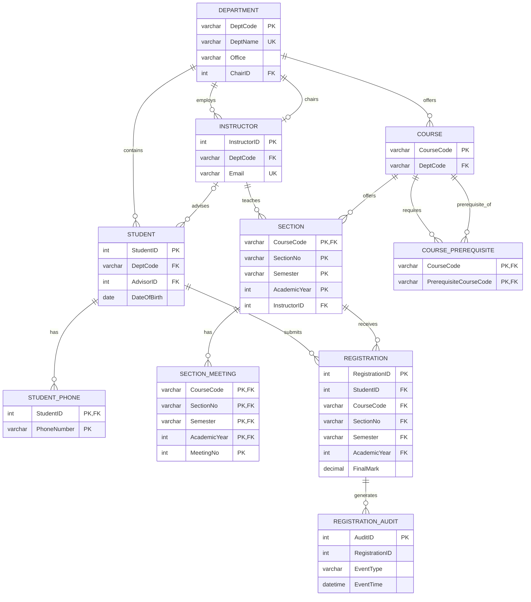

# University Project 1 — Entity Relationship Diagram

This is a GitHub-renderable overview of the relationships. The more detailed entity attributes, including composite primary keys and constraints, appear in [ERD.dot](ERD.dot) and [01_schema.sql](../sql/01_schema.sql).

> **Modeling note:** The audit connection is a historical/logical relationship, not an enforced foreign key. Audits survive registration deletion. The section identity is the composite key (CourseCode, SectionNo, Semester, AcademicYear). The SectionMeeting key includes the section composite key plus MeetingNo.
